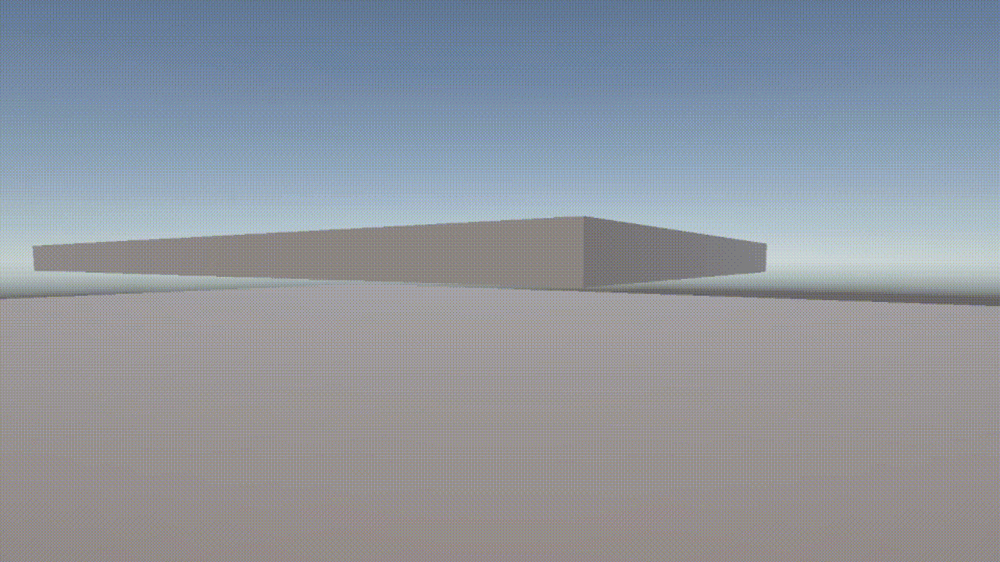

# Expandable First-Person Controller

[](https://opensource.org/licenses/MIT)
[](https://github.com/YOUR_USERNAME/YOUR_REPO/releases)

A modular and easily expandable first-person character controller for Unity. This asset is designed to provide a solid and responsive foundation for player movement that can be extended with new abilities (like crouching, sliding, or wall-running) without modifying the core controller code.


*Demonstration of the controller's core movement and modular abilities.*

---

## Table of Contents

- [Key Features](#key-features)
- [Installation](#installation)
  - [Prerequisites](#prerequisites)
- [How to Use](#how-to-use)
  - [Basic Setup](#basic-setup)
  - [Configuration](#configuration)
  - [Player Input](#player-input)
- [Architecture & Expansion](#architecture--expansion)
  - [Core Concepts](#core-concepts)
  - [Creating a New Ability](#creating-a-new-ability)
- [API Reference](#api-reference)
- [License](#license)

---

## Key Features

*   **🚶‍♂️ Core Movement:** Smooth and responsive walk, run, and jump mechanics.
*   **👁️ First-Person Camera:** Includes mouse-look, configurable sensitivity, and pitch clamping.
*   **🧩 Modular by Design:** Add new abilities like crouching, sliding, or wall-running as self-contained components.
*   **⚙️ Highly Configurable:** Tweak movement variables, camera settings, and ability parameters directly from the Inspector.
*   **🕹️ Input System Ready:** Built with Unity's new Input System in mind for robust and flexible control mapping.
*   **✅ Clean & Organized Code:** Written with clarity and maintainability in mind, including detailed comments.

---

## Installation

### Prerequisites

*   Unity 6.3 LTS or newer.
*   Unity's `Input System` package.

1.  **Download:**
    *   **Option A (Recommended):** Go to the Releases page and download the latest `.unitypackage`.
    *   **Option B (From Git):** Clone this repository into your project's `Assets` folder.
        ```bash
        git clone https://github.com/YOUR_USERNAME/YOUR_REPO.git YourProject/Assets/ExpandableFPS
        ```
2.  **Import:**
    *   If you downloaded the `.unitypackage`, import it into your Unity project via `Assets > Import Package > Custom Package...`.

---

## How to Use

### Basic Setup

1.  Drag the `Player` prefab from the `Assets/ExpandableFPS/Prefabs` folder into your scene.
2.  If your scene has a default Main Camera, delete it to avoid conflicts with the player's camera.
3.  Hit Play!

### Configuration

Select the `Player` object in the Hierarchy. In the Inspector, you will find several components that allow you to configure the controller's behavior:

*   **`PlayerMovement`:** Adjust variables like `walkSpeed`, `runSpeed`, `jumpForce`, and `gravity`.
*   **`PlayerLook`:** Change `mouseSensitivity` and the min/max look angles (`minXClamp`, `maxXClamp`).
*   **Ability Components (e.g., `CrouchAbility`):** Configure parameters specific to each ability, such as `crouchHeight` or `slideSpeed`.

### Player Input

This controller uses Unity's Input System for handling controls. The default mappings are already set up. To customize them:

1.  Navigate to the `Input` folder within the asset package.
2.  Open the `PlayerControls` Input Actions asset.
3.  Modify the key bindings for actions like `Move`, `Jump`, and `Run` to fit your project's needs.

---

## Architecture & Expansion

The controller is built around a central `PlayerController` script that manages a collection of "Abilities" (or "States"). Each ability is a self-contained component responsible for a single piece of functionality.

#### Core Concepts

*   **`PlayerController.cs`:** The main orchestrator. It doesn't contain movement logic itself but instead delegates to the active ability. It manages the state transitions between abilities.
*   **`PlayerAbility.cs`:** An abstract base class that all abilities must inherit from. It defines a common interface with methods like `CanEnter()`, `OnEnter()`, `OnUpdate()`, and `OnExit()`.
*   **`Ability Components`:** (e.g., `WalkAbility.cs`, `JumpAbility.cs`). These are concrete implementations of `AbilityBase`. You can enable or disable them on the player prefab to control which abilities are available.

### Creating a New Ability

Adding a new movement mechanic is straightforward:

1.  **Create a new C# script** (e.g., `DashAbility.cs`) that inherits from `AbilityBase`.
2.  **Implement the required methods:**
    *   `CanEnter()`: Define the conditions under which this ability can become active (e.g., player is on the ground and presses the dash button).
    *   `OnEnter()`: Code to run once when the ability starts (e.g., apply an initial dash force).
    *   `OnUpdate()`: The main logic loop for the ability.
    *   `OnExit()`: Cleanup code to run when the ability ends.
3.  **Add the new script** as a component to your `Player` prefab.
4.  The `PlayerController` will automatically discover and manage the new ability.

---

## API Reference

Key public members for scripting interactions with the `PlayerController`.

*   `PlayerController.IsGrounded`: Is the player currently on the ground?
*   `PlayerController.Move(Vector3 direction)`: Public method to apply external movement forces.
*   `PlayerController.EnableAbility<T>()` / `PlayerController.DisableAbility<T>()`: To enable or disable a specific ability at runtime.

*(Expand this section with more details about your public API.)*

---

## License

This project is licensed under the MIT License - see the LICENSE.md file for details.
